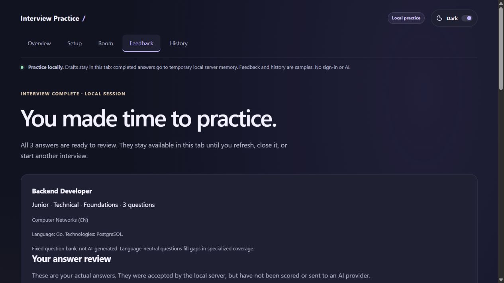

# Interview Practice

A full-stack learning project for software developer internships and junior roles.
**Current milestone: Phase 6 complete with live backend verification (2026-10-13). Phase 5 is pushed as ceed058.**

## What works

- General, frontend, backend and full-stack tracks; internship/junior levels; 3–10 questions selected on the backend.
- Answers stay attached to questions across previous/next navigation.
- Nonblank answers with a 3,000-character limit; all selected answers submitted on completion.
- Server-confirmed answer review, loading states, understandable errors and retries.
- Duplicate-safe starts and completion; backend validation and bounded requests.
- Responsive interface, light/dark toggle, accessible controls and motion preferences.
- Real PostgreSQL history, explicit Save progress, resume and deletion.
- Clerk account screens, Google sign-in support and private interview ownership. Mock/live AI question plans, up to two optional follow-ups, and persisted coaching reports; live backend verification passed.

## Run locally

Use Node.js 22.12+ (22.x) or Node 24+. Verified with Node 22.14.0 on Windows.
Run commands from the project root. Use npm.cmd if PowerShell blocks npm.ps1.

First-time setup:

```powershell
npm ci
npm run db:generate
Copy-Item server/.env.example server/.env
Copy-Item client/.env.example client/.env
```

Copy the example only when server/.env does not already exist; preserve existing
configuration. A local example .env was created during Phase 4 setup on this machine.
The documented development password is local-only, not a production credential.


## Clerk and Google sign-in setup

1. Create or select a development application in the [Clerk dashboard](https://dashboard.clerk.com/).
2. In **SSO connections**, add **Google** for all users and enable it for sign-up
   and sign-in. Development instances can use Clerk's shared Google OAuth
   credentials; production requires your own Google OAuth configuration.
3. Add the **same application's** publishable key to both files:
   - client/.env: VITE_CLERK_PUBLISHABLE_KEY
   - server/.env: CLERK_PUBLISHABLE_KEY
4. Add CLERK_SECRET_KEY only to server/.env. Never put it in VITE_* or paste it
   into chat, source files or version control. Both .env files are ignored.
5. Restart the API and Vite after changing keys. Open /sign-in in Chrome, Edge,
   Firefox or another regular browser, then choose Google. Embedded app browsers
   may be rejected by Google OAuth.
6. Sign in, create a new interview and verify Save progress → History → Resume.
   Sign out and use a second account; the first account's interviews must be absent.

The prebuilt Clerk SignIn/SignUp screens display enabled social providers, including
Google. The app does not handle your Google password or store Google access tokens.
No extra Google scopes are requested by application code.

Missing keys fail closed: the frontend shows setup guidance, and normal API startup
requires real Clerk configuration. There is no development-identity bypass.
Old Phase 4 records stay in PostgreSQL under legacy users and are not automatically
claimed by a new sign-in. New accounts begin with their own history.

References: [React setup](https://clerk.com/docs/react/getting-started/quickstart),
[Express verification](https://clerk.com/docs/reference/express/clerk-middleware),
[Google configuration](https://clerk.com/docs/guides/configure/auth-strategies/social-connections/google).

Terminal 1 — keep the database running:

```powershell
npm run db:local
```

The helper runs real PostgreSQL on 127.0.0.1:55432 and preserves files in
server/.data/postgres (ignored by Git). It does not install a Windows service.
Start one instance only. Ctrl+C stops it without deleting data.

Terminal 2 — initialize the schema, optionally seed, then start Express:

```powershell
npm run db:migrate
npm run dev:server
```

Migrations preserve existing records. Optional db:seed creates a legacy example,
not a record belonging to a signed-in account. It is unnecessary for normal use.

Terminal 3:

```powershell
npm run dev
```

Open http://127.0.0.1:5173. API health is http://127.0.0.1:3001/api/v1/health.
Keep this version local until deployment is configured. You can alternatively use an existing
local PostgreSQL database by setting DATABASE_URL in server/.env.

| Command | Purpose |
| --- | --- |
| npm run db:local | Persistent local PostgreSQL helper |
| npm run db:generate | Generate the JavaScript Prisma client |
| npm run db:migrate | Apply committed migrations |
| npm run db:seed | Add an explicitly labeled development example |
| npm run dev:server | Express with watch mode |
| npm run dev | Vite on port 5173 |
| npm test | 68 client/server checks; live-database tests run separately |
| npm run test:db | Nineteen real PostgreSQL checks in a fresh disposable database |
| npm run lint | Client, server and shared lint |
| npm run build | Production frontend build |
| npm run preview | Built frontend on port 4173; API/database still required |

test:db requires the local database role to have CREATE DATABASE privilege. It
creates and removes only a uniquely named interview_test_* database, never the
development database. npm test does not prove database persistence by itself.

## Manual check

1. Sign in with Google or another enabled method. Start an interview; type an answer and click Save progress.
2. Refresh, open History, and choose Resume interview. Revisit the saved answer.
3. Restart Express; reopen History and verify the same text and question order.
4. Complete all answers, then reopen the completed review from History.
5. Delete an interview: cancel once, then confirm; verify it disappears.
6. Stop the API and attempt to save an edit. The error preserves the browser draft.
7. Open the same interview in two tabs; save differing edits. The second stale save
   must fail. Copy any needed draft text before reopening the latest record.

There is no autosave. Unsaved edits remain browser memory only. Saved data has no
one-hour expiry and survives server restarts. Refresh recovery is through History.
Native refresh/close warnings still depend on the browser.

## Where to edit

- server/src/data/questions.js: the fixed bank (104 explicit-ID prompts with applicability metadata).
- server/src/routes/, controllers/, services/: HTTP routing and interview rules.
- server/src/validation.js and middleware/errors.js: validation and error format.
- client/src/interview/api.js: fetch requests and timeout/error handling.
- client/src/interview/InterviewContext.jsx: shared session and request state.
- client/src/pages/: setup, interview, feedback, history and overview screens.
- client/src/index.css and App.css: themes, layout and interactions.

Edit a question's text while retaining its stable ID. Start a new interview to
see the updated bank. Test and lint after behavioral changes; ordinary text edits
can be previewed directly through the development servers.

## Documentation

Start with the detailed [phase-by-phase project walkthrough](docs/PROJECT_WALKTHROUGH.md)
to understand how the implementation was built and trace the code yourself.

The [master requirements checklist](docs/REQUIREMENTS_CHECKLIST.md) tracks each
phase task. The [Phase 1–3 audit](docs/PROGRESS.md#historical-phase-13-audit) records completion evidence.
Documents are reviewed and updated after every phase under the root AGENTS.md rules.

The docs folder contains nine maintained Markdown files:

| File | Read it for |
| --- | --- |
| PROJECT_WALKTHROUGH.md | Detailed explanation of how each phase was built, through Phase 4 |
| PROGRESS.md | Current checkpoint, recorded checks, limitations and historical audit |
| PROJECT_BRIEF.md | Current master prompt; original prompt in a historical appendix |
| REQUIREMENTS_CHECKLIST.md | Individual requirements and completion evidence |
| ROADMAP.md | Phase sequence and acceptance summary |
| ARCHITECTURE.md | Current components, responsibilities and data flow |
| API.md | Current endpoint contracts, configuration and errors |
| LEARNING.md | Concepts and practice tasks by milestone |
| DEPLOYMENT.md | Environment, hosting plans and future release requirements |

Start with the walkthrough and progress. The screenshots subfolder retains actual
milestone evidence. Separate phase guides and audit files have been consolidated.

[Progress](docs/PROGRESS.md), [roadmap](docs/ROADMAP.md),
[architecture](docs/ARCHITECTURE.md), [API contracts](docs/API.md),
[learning notes](docs/LEARNING.md), [deployment](docs/DEPLOYMENT.md),
and [master requirements](docs/PROJECT_BRIEF.md).

Complete one phase at a time. No automatic commits, pushes or publication.




## Phase 3.1 configuration

Select automatic/balanced coverage or explicit subjects, including CN, OOP, DSA,
DBMS and OS. Technical slots equal the question count for Technical and its rounded-up
half for Mixed. Selected subjects each require at least one technical slot.
Behavioral-only interviews need no subjects. Language and up to five technologies
are preferences: specialized matches are used where available; neutral questions
cover gaps without substituting unrelated frontend content. Current specialist
prompts cover React, Python, Java and PostgreSQL; other choices use neutral concepts.
Difficulty adjusts the requested explanation depth within internship/junior scope.
In mock mode questions come from the fixed bank; live mode generates a new plan
with Gemini. Outages use an explicitly labeled fixed-bank fallback. Resume/JD personalization arrives in Phase 7. Code is never executed.


## Phase 6: AI setup and verification

Default `AI_MODE=mock` makes no Gemini calls. Mock report scores are fixed examples,
not assessments. Existing Clerk and database settings stay unchanged. Apply the
new migration with `npm run db:generate` and `npm run db:migrate`.

For live mode, add these to **server/.env only**, then restart the API:

```dotenv
AI_MODE=live
GEMINI_API_KEY=YOUR_GEMINI_API_KEY
GEMINI_MODEL=gemini-3.1-flash-lite
```

The model ID is configurable and must be available to your key. Never put Gemini
or Clerk secret keys in the client or in Git. Live mode sends interview preferences,
questions and (when requesting follow-ups/reports) saved answers to Google.

Start a new interview. The mode is disclosed in Setup and the question room.
Use **Save & ask a follow-up** for up to two base questions; new questions appear
at the end. Complete the interview, then choose **Generate feedback**. A report
failure does not undo saved completion. Reopen reports through History.

Checks: `npm test`, `npm run test:db`, `npm run lint`, `npm run build`.
`npm run eval:ai --workspace server` checks the 16-case evaluation dataset without
calling Gemini. For an explicitly authorized live check, run from server:
`node scripts/evaluate-ai.js --live` (four bounded report calls). It records only
subject-level scores, model and usage, not answer text. A passing small probe set
is not a reliable estimate of model accuracy. See docs/PROGRESS.md for actual evidence.

Limits: 30 AI operations per user per UTC day, one in flight per user, three globally,
45 seconds per operation, one extra attempt only after an explicit provider 429.
Ambiguous failures/timeouts are not replayed automatically: a provider may already
have billed the call. A stale in-flight record after a process crash is not retried.
Cached successes can be retrieved safely; unavailable reports keep the answer review.
Phase 6 live generation, follow-up, persisted report and evaluation checks passed.
No new browser/OAuth check is claimed. Phase 7 has not started.
